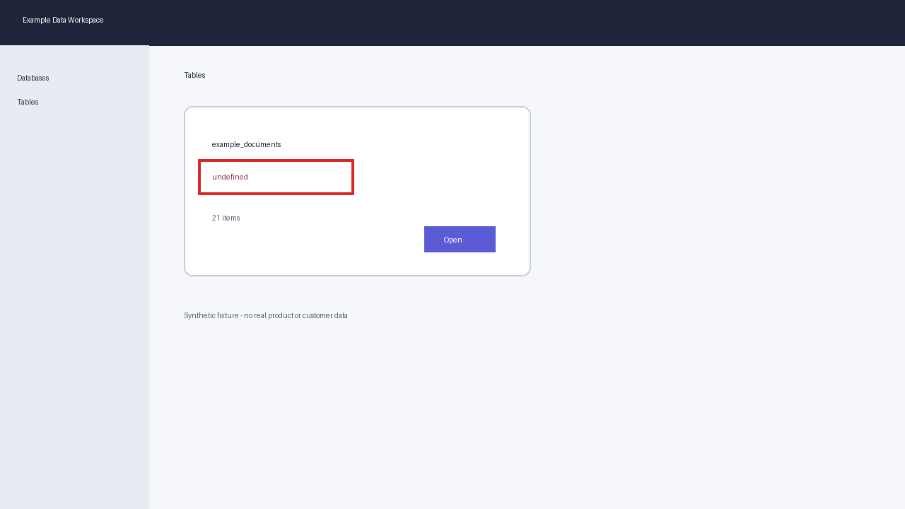

# Synthetic Web Application Bug Bash

## Test context

| Field | Value |
|---|---|
| Run ID | `synthetic-webapp-2026-10-13` |
| Source document | `synthetic-tutorial.md` |
| Target | https://example.test/databases/demo |
| Created | 2026-10-13T07:57:45Z |
| Report generated | 2026-10-13T07:57:45Z |

## Summary

- **Test cases:** 2
- **Confirmed findings:** 1
- **Evidence items:** 1
- **External submissions:** 1
- **Case results:** Issue: 1, Works: 1
- **Severity:** Medium: 1

## Test execution

| Check | Status | Expected | Actual | Evidence |
|---|---|---|---|---|
| `SETUP-001` - Open the database workspace | Works | The workspace opens and lists available tables. | The workspace opened and displayed the Tables page. |  |
| `BROWSE-001` - Understand the resource type from the table card | Issue | The table card displays a meaningful resource type. | The table card displays the literal value undefined. | `EVD-001` |

## Confirmed findings

### BUG-001 - Table card displays undefined as its resource type

- **Severity:** Medium
- **Area:** Database browsing
- **Affected checks:** `BROWSE-001`

**Reproduction**

1. Open the example database workspace.
2. Navigate to Tables.
3. Inspect the example_documents card.

**Expected:** The card displays a resource type such as Multimodal.

**Actual:** The card displays the literal value undefined.

**Impact:** Users cannot identify the table type and the resource list appears broken.

**Recommendation:** Render the resolved table type and use an explicit fallback label when metadata is unavailable.

**External tracking:** `DEMO-1234`

**Evidence**

`EVD-001` - example_documents card displays undefined below the table name

## Submission log

| Tracking ID | Check IDs | Finding IDs | Status |
|---|---|---|---|
| `DEMO-1234` | `BROWSE-001` | `BUG-001` | Awaiting triage |

## Evidence index

| Evidence | Check | Finding | Description | Attachment | Tracking ID |
|---|---|---|---|---|---|
| `EVD-001` | `BROWSE-001` | `BUG-001` | example_documents card displays undefined below the table name | Uploaded | `DEMO-1234` |
